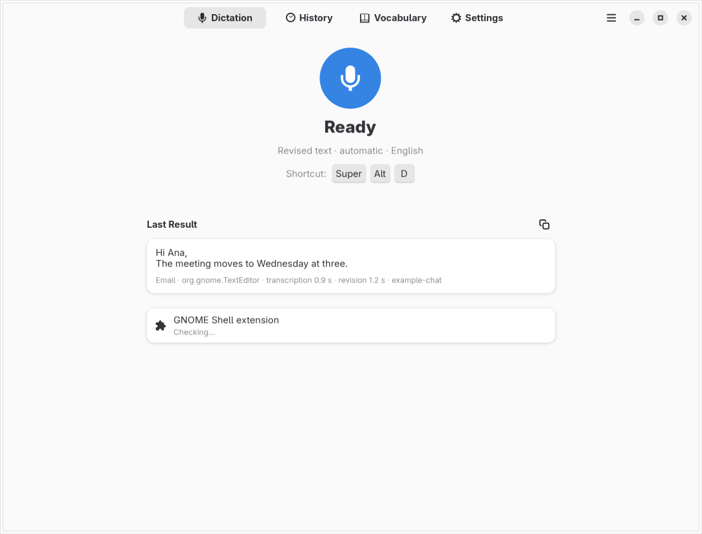

# Orfeu Scribe

*Português: [README.pt-BR.md](README.pt-BR.md)*

Voice dictation for GNOME. Press a shortcut in any app, speak, press again:
Orfeu Scribe sends the recording to a speech-to-text service **you** configure,
optionally revises the transcript with a language model, and pastes the result
at the cursor. Every dictation is kept in a local history with the original
transcript.

> **Early alpha — Linux / GNOME 51.** Released under [GPL v3 or later](LICENSE).
> This first public version has been validated with synthetic audio and local
> test services. Real microphone quality, paid providers and physical shortcuts
> still need broader testing. Windows and macOS are not supported yet.




## Features

- **Dictate anywhere** through a GNOME Shell extension: a small on-screen pill
  shows listening and progress; the text is pasted at the cursor and the
  clipboard is restored.
- **Your own service.** Any server that implements the OpenAI-style
  `/audio/transcriptions` endpoint for speech and `/chat/completions` for
  revision: OpenAI itself, or a local or self-hosted server. Transcription and
  revision can use different servers and keys. Revision is optional.
- **Writing modes:** revised text, literal dictation, message, email and AI
  instruction; optional *talk outline* and *video script* modes. The app in
  focus can choose the mode (editable rules).
- **Operations:** dictate, ask (answer in a card), translate, edit the selected
  text by voice ("make it shorter") or write from an instruction, reply with
  the visible conversation as context (off by default), revert the last paste
  to the raw transcript, paste the last dictation again.
- **Recover failed dictations:** if the service fails or you cancel, the audio is
  kept for 24 hours and can be recovered from History.
- **Guards:** the revision is checked for text copied from support material
  (earlier dictations, vocabulary, previous part); delivery is refused if the
  focused window changed; formatting commands must survive the revision.
- **Vocabulary** with spelling corrections (`wrong => right`), suggested from
  your own edits and added only when you accept them.
- **Interface in English and Brazilian Portuguese** (gettext), native
  libadwaita look, light and dark.

## Get the source

```sh
git clone https://github.com/lucasmariano003-wq/orfeu-scribe.git
cd orfeu-scribe
```

## Requirements

- Linux with **GNOME Shell 51** for the extension (the only version declared in
  `metadata.json`; see Compatibility). Without the extension, you can still
  dictate in the Orfeu Scribe window and copy the result.
- System Python 3 with **PyGObject**, **GTK 4**, **libadwaita ≥ 1.6** and
  **GStreamer 1.x** with the base and good plugins (`autoaudiosrc`,
  `audioconvert`, `audioresample`, `level`, `appsink`, `uridecodebin`).
- `glib-compile-schemas` (GLib).
- Optional: **libsecret** (store API keys in the GNOME keyring; otherwise use
  environment variables) and **AT-SPI** (fit dictation mid-sentence, reply with
  context).

On Arch Linux: `gtk4 libadwaita python-gobject gst-plugins-base gst-plugins-good libsecret at-spi2-core`.

## Install

```sh
git clone <repository> orfeuscribe && cd orfeuscribe
./install.sh --dry-run          # show what would be written
./install.sh                    # install for the current user
```

The installer copies the app to `~/.local/lib/orfeuscribe`, a launcher to
`~/.local/bin/orfeuscribe`, the extension to
`~/.local/share/gnome-shell/extensions/orfeuscribe@lucasmariano003-wq.github.io`, plus a
desktop entry and icons. It does **not** enable the extension, start the
service or turn on autostart. Then log out and back in, and run:

```sh
gnome-extensions enable orfeuscribe@lucasmariano003-wq.github.io
```

`./install.sh --home DIR` installs into another directory (useful for trying it
out). `./uninstall.sh` removes what was installed and keeps your settings,
history and vocabulary; `./uninstall.sh --purge` removes those too.

## First run

1. Open **Orfeu Scribe**. Without a service, the Dictation page shows *Set up a
   speech service* and nothing is ever sent.
2. **Settings → Speech-to-Text Service:** enter the server URL and model, and
   apply your API key (stored in the keyring). *Fill In OpenAI Defaults* fills
   `https://api.openai.com/v1` and `gpt-transcribe`.
3. **Settings → Text Revision:** keep *Use the same server and key* or set
   another server; enter a chat model (*List models* asks the server). Turn
   revision off to use only local cleanup.
4. **Settings → Shortcuts:** choose a combination for *Dictate* (none is set by
   default, so nothing collides with your existing shortcuts).
5. Dictate. The result is pasted at the cursor and saved in **History**.

Keys can also come from the environment: `ORFEUSCRIBE_STT_API_KEY` and
`ORFEUSCRIBE_REVISION_API_KEY` take precedence over the keyring.

## Configuring a service

| Setting | OpenAI | Local server (example) |
| --- | --- | --- |
| Server URL | `https://api.openai.com/v1` | `http://127.0.0.1:8000/v1` |
| Transcription model | `gpt-transcribe` | the server's model name |
| Revision model | a chat model available to your account | the server's chat model |
| API key | required | often not needed |

`https://` is required, except for servers on this computer (`127.0.0.1`,
`localhost`, `::1`), which may use `http://`. Redirects are refused so the key
is never sent to another host. *Vocabulary hints* decides how your vocabulary
and language reach the speech service: `keywords[]` and `languages[]` for
`gpt-transcribe`, or `language` and a short `prompt` for Whisper-style servers.
Details and sources: [docs/PROVIDERS.md](docs/PROVIDERS.md).

Calls to a paid service cost money. Orfeu Scribe makes one transcription call per
dictation (more with *Live text* or *Deliver in parts*) and one revision call
(two if the guard has to retry).

## Privacy and retention

- **Sent to the speech service:** the recorded audio (16 kHz mono WAV), the
  spoken language and your vocabulary terms as hints.
- **Sent to the revision service:** the transcript, the mode, the window class
  and title, your vocabulary, and — only if you turn them on — up to five
  earlier texts as style examples (*Learn from history*) and up to 3,000
  characters of the visible conversation (*Reply with conversation context*).
- **Kept on this computer:** history in `~/.local/share/orfeuscribe/history.db`
  (private permissions; forever by default, or for the number of days you set),
  audio only if *Keep audio of the last dictations* is above 0, failed or
  cancelled audio for 24 hours in `~/.local/share/orfeuscribe/rescue/`,
  settings in `~/.config/orfeuscribe/settings.json`, vocabulary in
  `~/.config/orfeuscribe/vocabulary.txt`, API keys in the keyring.
- Error messages never include server responses or keys. Orfeu Scribe has no
  telemetry.
- The optional **physical key gestures** read `/dev/input` directly and require
  membership in the `input` group, a broad permission; they are off by default.

## Spoken commands

At the end of a sentence (the recognizer's punctuation counts):

| | English | Português | Español |
| --- | --- | --- | --- |
| period | full stop | ponto final | punto final |
| line break | new line | nova linha | nueva línea |
| paragraph | new paragraph | novo parágrafo | nuevo párrafo |
| discard the dictation | cancel dictation | apaga tudo | cancelar dictado |

"in Spanish: …" (or "em espanhol:", "en español:") at the start switches the
language of one dictation. With a notes folder configured, "note: …" or
"note in Ideas: …" appends to a daily Markdown file instead of pasting.

## Command line

```sh
orfeuscribe --test-audio sample.wav --json   # transcribe and revise a WAV with your settings
orfeuscribe --transcribe talk.mp4            # long audio/video file into History, in parts
orfeuscribe --export history.md              # private Markdown or CSV export
orfeuscribe --import history.csv
```

## Compatibility

Verified on 2026-10-22 on Arch Linux with Python 3.14, GTK 4.24,
libadwaita 1.10, GStreamer and GNOME Shell 51.1, using synthetic data only:

- 157 isolated Python tests and the GJS regression checks;
- installation and removal in a temporary home, including license files;
- twenty real GTK screenshots in English and Portuguese, light and dark;
- the renamed GNOME Shell extension, synthetic recording, local fake
  transcription/revision service and text delivery into a real test editor.

The Shell proof uses a private HOME/XDG environment and session bus, and
cleans up its test processes and temporary portal mount. GNOME reads the
host system bus during startup. Dictation is initiated through the test
harness, not a physical shortcut. See [the proof record](docs/verification/shell-proof.json).

**Not verified yet:** a real microphone or speech/language-model service,
physical shortcut handling, every card/revert path, screen-reader access,
or other distributions and GNOME versions. This is currently a Linux/GNOME
application; Windows and macOS are not supported.

## Limitations

- OpenAI-compatible APIs only. Streaming transcription, text-to-speech
  read-back and web search in answers are not available in this version.
- Prompts were translated from Portuguese and generalized; they have not yet
  been measured against an evaluation set in any language.
- Spoken commands exist for English, Portuguese and Spanish only.
- Wayland pasting goes through the extension's virtual keyboard and clipboard;
  apps that ignore Ctrl+V (or Ctrl+Shift+V in terminals) will not receive text.
- One recording is limited to 10 minutes; files are split into 5-minute parts.

## Development

```sh
scripts/run_tests.py                    # all tests, isolated HOME, no display, no bus
scripts/smoke_window.py [--language pt_BR]   # build the window without showing it
scripts/prove_ui.sh                     # screenshots in a private Xvfb (needs xvfb-run, dbus-run-session)
scripts/audit.py                        # personal references, legacy names, secret-like strings
scripts/extract_strings.py [--check]    # update or check translations
```

See [CONTRIBUTING.md](CONTRIBUTING.md) and [docs/ARCHITECTURE.md](docs/ARCHITECTURE.md).

## Credits

Derived from Calamus, a private dictation app; see [ATTRIBUTION.md](ATTRIBUTION.md).

## License

The application, GNOME Shell extension and project-owned material are licensed
under the **GNU General Public License, version 3 or later**
(`GPL-3.0-or-later`). See [LICENSE](LICENSE) and [NOTICE](NOTICE).
External dependencies keep their own licenses. This grant applies to this
independent project; it does not relicense the private Calamus repository.
