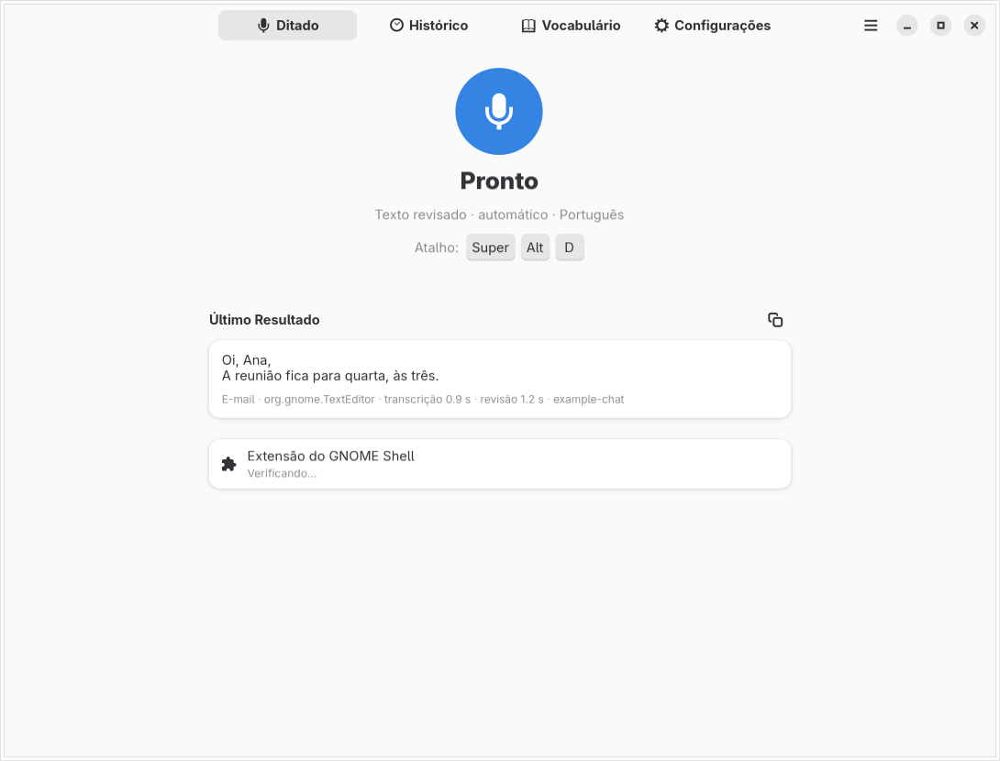

# Orfeu Scribe

*English: [README.md](README.md)*

Ditado por voz para o GNOME. Aperte um atalho em qualquer aplicativo, fale,
aperte de novo: o Orfeu Scribe envia a gravação a um serviço de transcrição que
**você** configura, revisa a transcrição com um modelo de linguagem (se você
quiser) e cola o resultado no cursor. Cada ditado fica num histórico local,
com a transcrição original.

> **Alpha inicial — Linux / GNOME 51.** Publicado sob [GPL v3 ou posterior](LICENSE).
> Esta primeira versão pública foi validada com áudio sintético e serviços
> locais de teste. Qualidade com microfone real, provedores pagos e atalhos
> físicos ainda precisam de testes mais amplos. Windows e macOS ainda não
> são suportados.




## Recursos

- **Dite em qualquer lugar** pela extensão do GNOME Shell: uma pequena pílula
  na tela mostra a escuta e o andamento; o texto é colado no cursor e a área de
  transferência é restaurada.
- **Seu próprio serviço.** Qualquer servidor com os endereços no estilo da
  OpenAI, `/audio/transcriptions` para a fala e `/chat/completions` para a
  revisão: a própria OpenAI ou um servidor local ou próprio. Transcrição e
  revisão podem usar servidores e chaves diferentes. A revisão é opcional.
- **Modos de escrita:** texto revisado, ditado literal, mensagem, e-mail e
  instrução para IA; modos opcionais de *roteiro de fala* e *roteiro de vídeo*.
  O aplicativo em foco pode escolher o modo (regras editáveis).
- **Operações:** ditar, perguntar (resposta num cartão), traduzir, editar por
  voz o texto selecionado ("deixe mais curto") ou redigir a partir de uma
  instrução, responder usando a conversa visível como contexto (desligado por
  padrão), voltar a última colagem à transcrição crua, colar de novo o último
  ditado.
- **Recuperação de ditados:** se o serviço falhar ou você cancelar, o áudio
  fica guardado por 24 horas e pode ser recuperado no Histórico.
- **Guardas:** a revisão é conferida contra texto copiado do material de apoio
  (ditados anteriores, vocabulário, parte anterior); a entrega é recusada se a
  janela em foco mudou; os comandos de formatação precisam sobreviver à revisão.
- **Vocabulário** com correções de grafia (`errado => certo`), sugeridas a
  partir das suas próprias edições e acrescentadas só quando você aceita.
- **Interface em inglês e português do Brasil** (gettext), visual nativo
  libadwaita, claro e escuro.

## Requisitos

- Linux com **GNOME Shell 51** para a extensão (a única versão declarada em
  `metadata.json`; veja Compatibilidade). Sem a extensão, ainda dá para ditar
  na janela do Orfeu Scribe e copiar o resultado.
- Python 3 do sistema com **PyGObject**, **GTK 4**, **libadwaita ≥ 1.6** e
  **GStreamer 1.x** com os plugins base e good (`autoaudiosrc`,
  `audioconvert`, `audioresample`, `level`, `appsink`, `uridecodebin`).
- `glib-compile-schemas` (GLib).
- Opcionais: **libsecret** (guardar as chaves de API no chaveiro do GNOME;
  sem ela, use variáveis de ambiente) e **AT-SPI** (encaixar o ditado no meio
  da frase, responder com contexto).

No Arch Linux: `gtk4 libadwaita python-gobject gst-plugins-base gst-plugins-good libsecret at-spi2-core`.

## Instalação

```sh
git clone <repositório> orfeuscribe && cd orfeuscribe
./install.sh --dry-run          # mostra o que seria escrito
./install.sh                    # instala para o usuário atual
```

O instalador copia o aplicativo para `~/.local/lib/orfeuscribe`, um lançador
para `~/.local/bin/orfeuscribe`, a extensão para
`~/.local/share/gnome-shell/extensions/orfeuscribe@lucasmariano003-wq.github.io`, além
de uma entrada de menu e ícones. Ele **não** ativa a extensão, não inicia o
serviço e não liga a inicialização automática. Depois, saia e entre de novo na
sessão e execute:

```sh
gnome-extensions enable orfeuscribe@lucasmariano003-wq.github.io
```

`./install.sh --home PASTA` instala em outra pasta (útil para experimentar).
`./uninstall.sh` remove o que foi instalado e conserva configurações,
histórico e vocabulário; `./uninstall.sh --purge` remove também esses dados.

## Primeira execução

1. Abra o **Orfeu Scribe**. Sem serviço configurado, a página Ditado mostra
   *Configure um serviço de fala*, e nada é enviado.
2. **Configurações → Serviço de Transcrição:** informe a URL do servidor e o
   modelo e aplique sua chave de API (guardada no chaveiro). *Preencher Padrões
   da OpenAI* preenche `https://api.openai.com/v1` e `gpt-transcribe`.
3. **Configurações → Revisão de Texto:** mantenha *Usar o mesmo servidor e a
   mesma chave* ou defina outro servidor; informe um modelo de chat (*Listar
   modelos* pergunta ao servidor). Desligue a revisão para usar só a limpeza local.
4. **Configurações → Atalhos:** escolha uma combinação para *Ditar* (nenhuma
   vem definida, para não colidir com seus atalhos).
5. Dite. O resultado é colado no cursor e salvo no **Histórico**.

As chaves também podem vir do ambiente: `ORFEUSCRIBE_STT_API_KEY` e
`ORFEUSCRIBE_REVISION_API_KEY` têm precedência sobre o chaveiro.

## Configurar um serviço

| Configuração | OpenAI | Servidor local (exemplo) |
| --- | --- | --- |
| URL do servidor | `https://api.openai.com/v1` | `http://127.0.0.1:8000/v1` |
| Modelo de transcrição | `gpt-transcribe` | o nome do modelo no servidor |
| Modelo de revisão | um modelo de chat disponível na sua conta | o modelo de chat do servidor |
| Chave de API | obrigatória | muitas vezes desnecessária |

É exigido `https://`, salvo para servidores neste computador (`127.0.0.1`,
`localhost`, `::1`), que podem usar `http://`. Redirecionamentos são recusados,
para que a chave nunca vá a outro endereço. *Dicas de vocabulário* decide como
o vocabulário e a língua chegam ao serviço de fala: `keywords[]` e
`languages[]` para o `gpt-transcribe`, ou `language` e um `prompt` curto para
servidores no estilo Whisper. Detalhes e fontes:
[docs/PROVIDERS.md](docs/PROVIDERS.md).

Chamadas a um serviço pago custam dinheiro. O Orfeu Scribe faz uma chamada de
transcrição por ditado (mais com *Texto ao vivo* ou *Entregar em partes*) e uma
de revisão (duas, se a guarda precisar refazer).

## Privacidade e retenção

- **Vai ao serviço de fala:** o áudio gravado (WAV mono de 16 kHz), a língua
  falada e os termos do seu vocabulário como dicas.
- **Vai ao serviço de revisão:** a transcrição, o modo, a classe e o título da
  janela, seu vocabulário e — só se você ligar — até cinco textos anteriores
  como exemplos de estilo (*Aprender com o histórico*) e até 3.000 caracteres
  da conversa visível (*Responder com o contexto da conversa*).
- **Fica neste computador:** o histórico em
  `~/.local/share/orfeuscribe/history.db` (permissões privadas; para sempre por
  padrão, ou pelo número de dias que você definir), áudio só se *Guardar o áudio
  dos últimos ditados* for maior que 0, áudio de ditados com falha ou cancelados
  por 24 horas em `~/.local/share/orfeuscribe/rescue/`, configurações em
  `~/.config/orfeuscribe/settings.json`, vocabulário em
  `~/.config/orfeuscribe/vocabulary.txt` e chaves de API no chaveiro.
- As mensagens de erro nunca trazem respostas do servidor nem chaves. O
  Orfeu Scribe não tem telemetria.
- Os **gestos de teclas físicas**, opcionais, leem `/dev/input` diretamente e
  exigem participar do grupo `input`, uma permissão ampla; vêm desligados.

## Comandos falados

No fim de uma frase (a pontuação do reconhecedor conta):

| | English | Português | Español |
| --- | --- | --- | --- |
| ponto | full stop | ponto final | punto final |
| quebra de linha | new line | nova linha | nueva línea |
| parágrafo | new paragraph | novo parágrafo | nuevo párrafo |
| descartar o ditado | cancel dictation | apaga tudo | cancelar dictado |

"em espanhol: …" (ou "in Spanish:", "en español:") no começo muda a língua
daquele ditado. Com uma pasta de notas configurada, "nota: …" ou "nota em
Ideias: …" acrescenta a um arquivo Markdown do dia, em vez de colar.

## Linha de comando

```sh
orfeuscribe --test-audio amostra.wav --json   # transcreve e revisa um WAV com suas configurações
orfeuscribe --transcribe palestra.mp4         # arquivo longo de áudio/vídeo para o Histórico, em partes
orfeuscribe --export historico.md             # exportação privada em Markdown ou CSV
orfeuscribe --import historico.csv
```

## Compatibilidade

Verificado em 22/10/2026 no Arch Linux com Python 3.14, GTK 4.24,
libadwaita 1.10, GStreamer e GNOME Shell 51.1, somente com dados sintéticos:

- 157 testes isolados em Python e as verificações de regressão em GJS;
- instalação e remoção numa pasta pessoal temporária, incluindo as licenças;
- vinte capturas reais do GTK em inglês e português, nos temas claro e escuro;
- extensão com o novo nome, gravação sintética, serviço local falso de
  transcrição/revisão e entrega do texto em um editor real de teste.

A prova do Shell usa HOME/XDG e barramento de sessão privados, e encerra os
processos e a montagem temporária do portal. O GNOME lê o barramento de sistema
da máquina ao iniciar. O ditado é acionado pelo teste, não por uma tecla física.
Veja [o registro da prova](docs/verification/shell-proof.json).

**Ainda não verificados:** microfone e serviços reais de fala/linguagem,
atalhos físicos, todos os caminhos de cartão/reversão, leitor de tela,
outras distribuições e versões do GNOME. Atualmente este é um aplicativo
para Linux/GNOME; Windows e macOS não são suportados.

## Limitações

- Só APIs compatíveis com a OpenAI. Transcrição em fluxo, leitura em voz alta
  e busca na web nas respostas não existem nesta versão.
- Os prompts foram traduzidos do português e generalizados; ainda não foram
  medidos contra um conjunto de avaliação em nenhuma língua.
- Comandos falados só em inglês, português e espanhol.
- No Wayland a colagem passa pelo teclado virtual e pela área de transferência
  da extensão; aplicativos que ignoram Ctrl+V (ou Ctrl+Shift+V nos terminais)
  não recebem o texto.
- Uma gravação vai até 10 minutos; arquivos são divididos em partes de 5 minutos.

## Desenvolvimento

```sh
scripts/run_tests.py                    # todos os testes, HOME isolado, sem tela, sem barramento
scripts/smoke_window.py [--language pt_BR]   # monta a janela sem mostrá-la
scripts/prove_ui.sh                     # capturas num Xvfb privado (precisa de xvfb-run, dbus-run-session)
scripts/audit.py                        # referências pessoais, nomes antigos, textos parecidos com segredos
scripts/extract_strings.py [--check]    # atualiza ou confere as traduções
```

Veja [CONTRIBUTING.md](CONTRIBUTING.md) e [docs/ARCHITECTURE.md](docs/ARCHITECTURE.md).

## Créditos

Derivado do Calamus, um aplicativo privado de ditado; veja [ATTRIBUTION.md](ATTRIBUTION.md).

## Licença

O aplicativo, a extensão do GNOME Shell e os materiais próprios do projeto
estão sob a **GNU General Public License, versão 3 ou posterior**
(`GPL-3.0-or-later`). Veja [LICENSE](LICENSE) e [NOTICE](NOTICE).
Dependências externas mantêm suas próprias licenças. Esta decisão vale para
a cópia independente e não muda a licença do repositório privado do Calamus.
